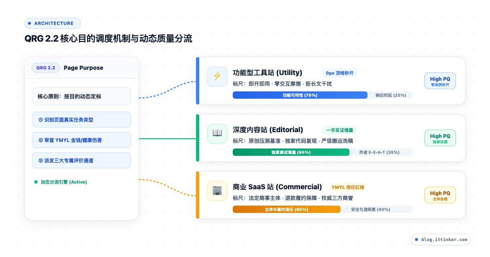
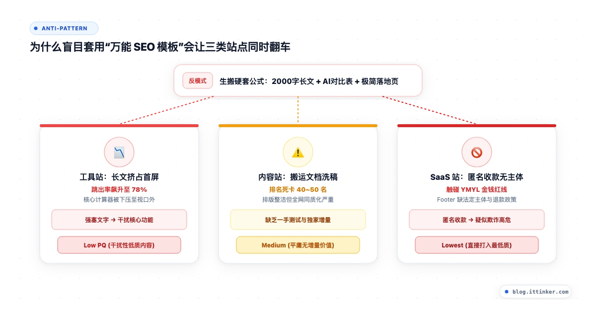
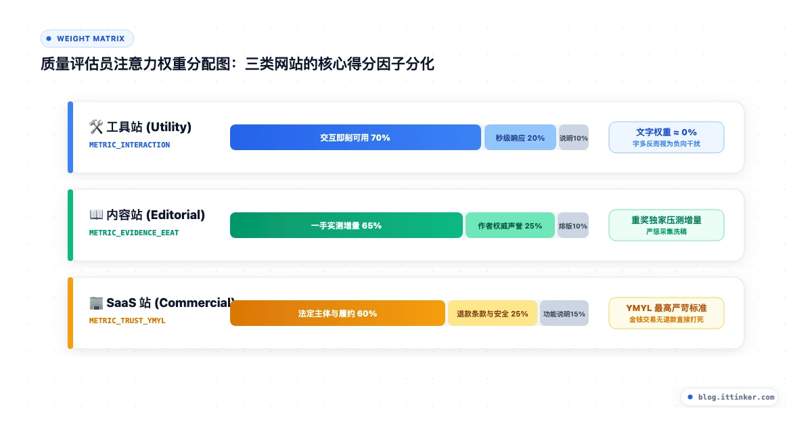
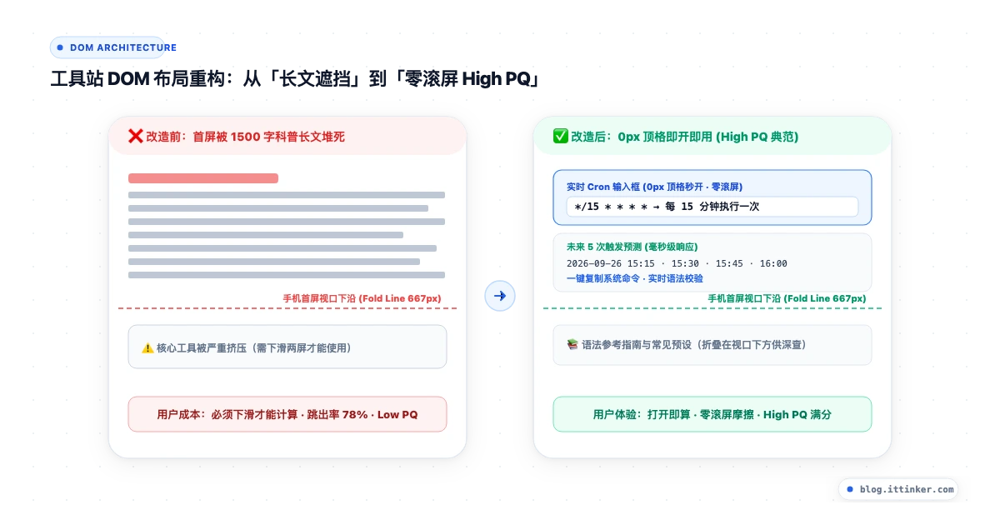
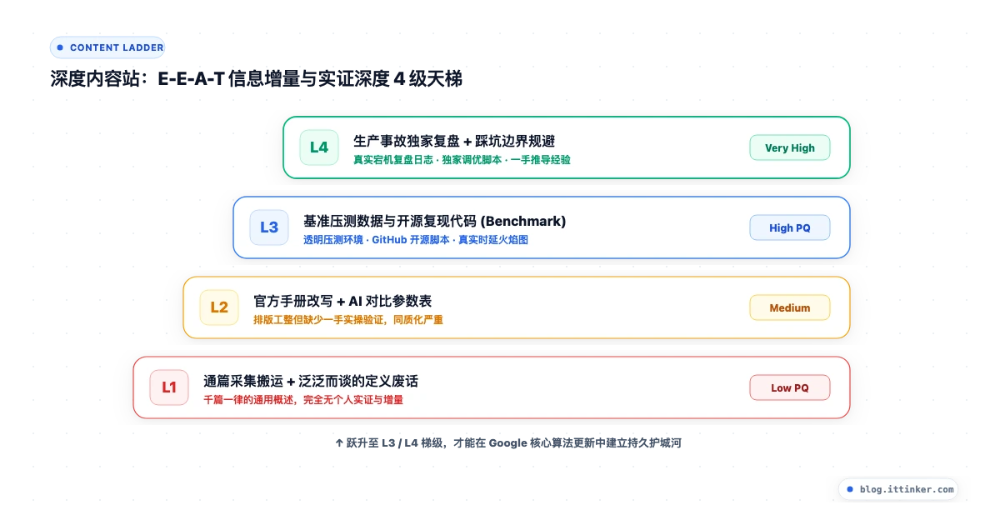
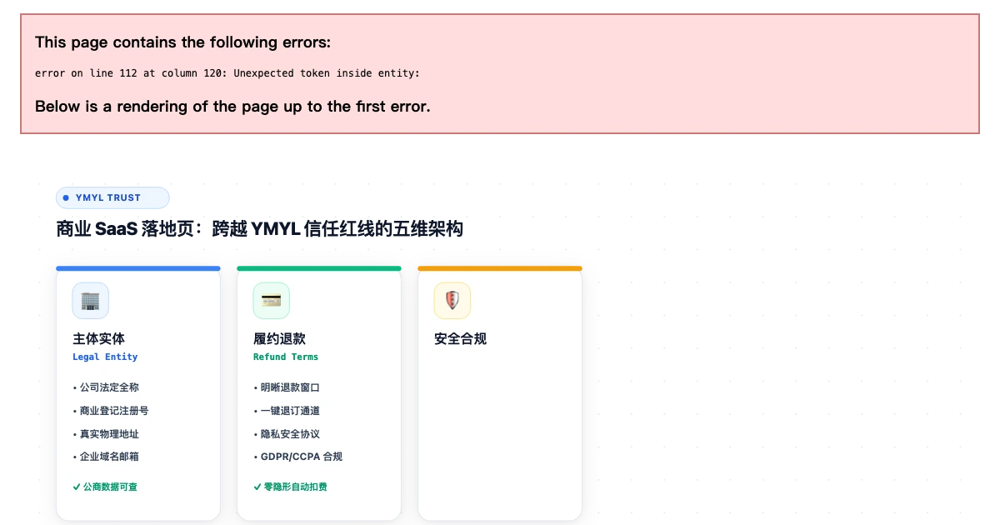
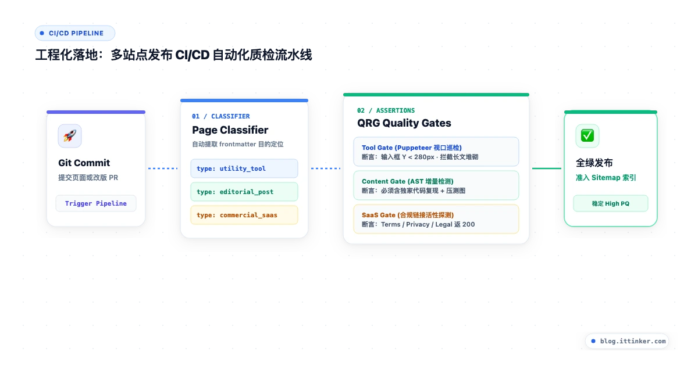

# “SEO 模板同时翻车”？实测工具站、内容站与 SaaS 质量标尺 | 读懂 Google Search SEO 实战 系列 050

> 🌐 **在线阅读与互动版**：[“SEO 模板同时翻车”？实测工具站、内容站与 SaaS 质量标尺 | 读懂 Google Search SEO 实战 系列 050](https://blog.ittinker.com/posts/商业网站同时翻车-满分-seo-模板-qrg-实测/)
> 📚 **所属专栏**：[《读懂 Google Search：110篇搜索质量与SEO实战指南》](../README.md)

---

### 📌 结论先行（TL;DR）
> **Google QRG 确立不可动摇的审查红线：市面上根本不存在放之四海皆准的网页质量模板。**
>
> - **警示**：盲目生搬硬套“2,000 字长文 + 华丽排版”只会引发评价标尺错配，导致跳出率飙升或被打入低质。
> - **工具型页面**：做减法——追求功能即刻可用与交互零摩擦，首屏（Y < 280px）直达操作区，移除长文遮挡。
> - **深度技术内容**：做增量——追求一手实证、独家代码与深度见解，杜绝汇总文档的二道贩子改写。
> - **商业 SaaS 官网**：做透明——强化注册实体、物理办公地址与履约保障，跨越 YMYL 交易信任红线。




---

## 0. 从问题出发：为什么一套“满分 SEO 模板”会让三个站点同时翻车？

做独立开发和出海矩阵站时，我见过太多开发者试图总结一套“万能高权重页面公式”——比如：**每个页面必须凑够 2,000 字长文 + 3 个 H2 小标题 + FAQ 折叠框 + 精美 Tailwind 卡片**。

但当你把同一套“SEO 标准动作”生搬硬套到不同形态的产品上时，往往会遭遇令人困惑的滑铁卢：
- **工具站翻车**：你做了一个极速在线 Cron 表达式生成器，为了“增加关键词密度”，在输入框上方塞了 1,500 字《什么是 Linux Crontab 历史与语法百科》。结果改版两周后，移动端跳出率飙升到 78%，主词排名直接掉出前 30。
- **内容站滞涨**：你写了一篇排版极其工整、涵盖 10 个维度的《PostgreSQL vs ClickHouse 选型对比》，字数突破 4,000 字，但全篇都是官方文档参数的汇总改写。上线三个月，Google Search Console 显示已收录，但排名死死卡在第 45 名（对应 QRG 的 `Low ~ Medium` 区间）。
- **SaaS 落地页被判败诉**：你花三天时间用 Next.js + Framer Motion 搭了一个极其酷炫的 B2B API 监控 SaaS 官网，接好了 Stripe 信用卡收款，但因为想“保持页面极简 + 保护个人隐私”，Footer 里既没有公司注册实体，也没有办公地址和退款条款。在质量评估员盲审中，这个页面连 `Low` 都拿不到，直接被打入 **`Lowest`（疑似欺诈/无主体高危交易页）**。

为什么同样的优化思路，在三类网站上引发了截然不同的灾难？下面的问题现场解剖图还原了这三类错配事故的触发链路：



---


### 🚨 2026 → 2024 官方最新风向预警：Google 对三大主流商业站点形态在 Google 质量标尺下的分化实测的策略演进

#### 🕒 2026 → 2024 Google 官方对三大主流商业站点形态在 Google 质量标尺下的分化实测的策略演进

- **2026 · 形态错配作为最大的降权黑天鹅（Architectural Mismatch Crisis）**
  将工具站做成百科全书、将 SaaS 官网做成无休止博客、将内容站做成冷冰冰列表——一套看似满分的通用模板，由于未能根据站点形态对准 QRG 差异化标尺，在同一次算法更新中遭遇全军覆没。

- **2025 · 量体裁衣式的差异化架构标准确立**
  深入解构了工具站（重在即时交付与零废话）、SaaS 站（重在主体透明度与安全履约）与内容站（重在第一手实证与独家洞察）三大截然不同的质量考核重心。

- **2024 · QRG 总体思想在复杂多站点矩阵规划中的高阶运用**
  告诫所有出海创业团队：世界上根本不存在放之四海而皆准的万能 SEO 模板，唯有对准特定站点形态的本质使命，才能立于不败之地。


---


## 1. 底层机制：QRG 是如何根据“页面目的”切换评分标尺的？

在 Google 质量评估员眼中，评估任何网页的第一步，**绝对不是去数它有多少个字、有几个 H2 标签**，而是先运行一套严密的“前置分类器”——识别页面的核心目的（Page Purpose）与潜在伤害半径（YMYL Spectrum）。

QRG 第 2.2 节与第 5.0 节对此做出了界限分明的定义：

> *"The purpose of a page is the reason or reasons why the page was created. As long as the page was created to help users, we will not consider any particular page purpose or type to be 'higher quality' than another. A fashion gossip website can be High quality, just like a scientific report website can be High quality."*
> — **Google QRG 2.2《What is the Purpose of a Webpage?》**

> *"The standard for 'High' quality depends on the purpose of the page. For example, High quality informational content should be factually accurate and comprehensively written. High quality functional pages should allow users to accomplish their tasks easily and effectively."*
> — **Google QRG 5.0《High Quality Pages》**

这意味着评估员脑中运行的是一棵**动态条件分支树**。一旦页面目的（Purpose）确定，后续衡量主内容心血（MC Effort）、辅助内容边界（SC）、作者背书（E-E-A-T）与站点透明度（Who is Responsible）的打分公式就会发生彻底切换：

---

## 2. 权重分化：评估员审视三类网站时的注意力分配

为什么工具站写太多字反而扣分，而 SaaS 站少写一行公司地址就会致命？因为评估员在给不同类型页面打 Page Quality（PQ）分时，四个核心维度的权重分配存在巨大倾斜：



---

## 3. 现场盲测：三个真实形态标的的 DOM 结构与死穴对比

为了把这套抽象准则落到代码和像素层面，我们选取软件工程领域最典型的三个真实标的，逐一拆解它们的 **高分页面布局（High PQ）** 与 **常见致死布局（Low/Lowest PQ）**：

### 标的 1：纯功能在线工具（Cron 表达式生成与解释器）
- **核心交互**：输入 `*/15 * * * *`，实时生成“Every 15 minutes”的可读说明与未来 5 次触发时间列表。
- **QRG 评分实测**：
  - **MC 判定**：功能响应时间低于 50ms，边界值（如 `L`、`W`、`#` 复杂语法）解析准确，提供一键复制按钮。评定为 **High MC**。
  - **常见死穴**：许多站长在核心输入框上方塞满关于“什么是 Linux Crontab”的长篇大论，迫使用户在移动端向下滑动两屏才能找到输入框。这种干扰布局在 QRG 6.3 中会被判定为“Distracting Ads or SC that prevents users from using the MC”，直接导致 PQ 降级。
  - **结论**：对工具站而言，**首屏零摩擦就是最高品质**。任何辅助说明文档都必须下沉到交互工作台下方（Below the Fold）。



### 标的 2：深度技术内容站（分布式数据库选型深度实测）
- **核心交互**：一篇 4000 字的《PostgreSQL vs ClickHouse 亿级时序数据查询实测对比》。
- **QRG 评分实测**：
  - **MC 判定**：文章展示了测试集群的硬件规格（CPU 核心、NVMe 固态型号）、具体的压测脚本、带时间戳的查询延迟监控图表，以及踩坑遇到的 OOM 崩溃日志。评定为 **Highest MC**。
  - **常见死穴**：如果是 AI 抓取两家官网宣传册改写的“ClickHouse 适合分析、Postgres 适合事务”八股对比，没有真实的测试数据与自测命令，即便结构工整，QRG 也会判定为“Little to no added value”，封顶只能拿 **Low**。
  - **结论**：对内容站而言，**只有一手现场感、复现成本与验证过程才是硬通货**。



### 标的 3：商业 B2B SaaS 落地页（API 异常监控云平台）
- **核心交互**：展示产品核心特性、实时大盘截图、定价套餐与“Start Free Trial”注册入口。
- **QRG 评分实测**：
  - **E-E-A-T 判定**：由于涉及付费订阅与信用卡绑定，该页面直接落入 **YMYL（Financial Transaction）** 范畴。审查重点立即转向法律主体与履约保证。
  - **关键审查点**：网站 Footer 必须包含真实的注册公司名称、实体办公地址、支持邮箱以及 Stripe 支付安全标识；必须包含公开透明的退订机制与 Terms of Service。
  - **常见死穴**：很多出海独立开发者用虚构的欧美名字作为创始人，没有公司登记信息，没有退款政策声明，甚至域名 Whois 开启全面隐私隐藏。在评估员眼里，这类站点具有潜在欺诈风险，PQ 直接定级为 **Lowest**。
  - **结论**：对商业 SaaS 而言，**主体透明度与风控证明远高于炫技的前端动画**。



---

## 4. 结构化横向对照表

| 评估维度 | 工具站（Utility Tool） | 深度内容站（Content/Blog） | 商业 SaaS（Commercial Landing） |
| :--- | :--- | :--- | :--- |
| **页面核心目的** | 帮助用户即刻完成具体计算、格式化或生成任务 | 提供客观准确、具有深度见解的信息或教程 | 说明商业价值、建立信任并引导付费或试用 |
| **YMYL 敏感度** | 低（除非涉及税务计算、加密货币钱包生成） | 视话题而定（架构选型属于普通技术，涉及医疗财务为高危） | **极高**（涉及金钱交易、用户商业数据存储与隐私） |
| **Effort 衡量标准** | 代码健壮度、交互流畅度、零报错、极端输入容错 | 一手实测、代码自测复现、架构拓扑图、真实数据沉淀 | 产品功能真实度、SLA 保证、集成文档与演示可用性 |
| **致命减分项** | 功能失效报错、强制注册弹窗拦截、大段文本遮挡输入区 | 纯通识重写、改写 AI 套话、缺乏实证、失效代码块 | 隐瞒运营主体、模糊收费标准、无退订条款、虚假客户背书 |
| **PQ 定级上限** | 纯工具很难达到 Highest，但优秀交互极易拿到 **High** | 拥有独家突破性评测与业界权威作者，可冲刺 **Highest** | 具有极强行业口碑、合规透明的知名 SaaS，可达 **High/Highest** |

---

## 5. 工程化落地：如何搭建按站点类型分流的 CI/CD 质检门禁？

如果你手头同时维护着工具矩阵、技术博客和 SaaS 官网，千万不要用同一套字数检查脚本去跑 CI。你应该在发布流水线里先根据路由或页面 Schema 类型分流，再执行对应的 QRG 专项检查：



在为不同项目规划页面结构时，请根据站点类型逐项核对以下上线清单：

- [ ] **工具站减法排查**：检查移动端（390×844 视口）核心操作区首屏 Y 轴坐标是否小于 `280px`，将一切概念科普文字移入操作区下方或折叠面板中。
- [ ] **工具站异常处理**：输入非法数据（如格式损坏的 JSON 或不合法的 Cron）时，前端是否给出友好清晰的报错指引而非界面白屏崩溃。
- [ ] **内容站一手证据核验**：文章是否包含作者亲自运行的代码块、压测命令或独家 SVG 架构图，剔除任何没有论据支撑的泛化论断。
- [ ] **内容站署名规范**：文章顶部标注真实作者名字与资历链接，底部附带完整的方法论与参考依据。
- [ ] **SaaS 站合规穿透**：落地页明确展示注册公司名、真实办公地址、退款说明（Refund Policy）与服务协议。
- [ ] **全站网络与安全加固**：使用 Cloudflare 规范化 SSL 与安全规则，杜绝因证书失效或脚本劫持导致的安全性降级。

针对出海服务的基础设施部署与域名接入规范，建议使用自动化脚本规范化设置反向代理与 SSL 策略（参考代码仓库 [ittinker-com/ittinker-scripts](https://github.com/ittinker-com/ittinker-scripts/tree/main/cloudflare-domain-baseline)）：

```bash
# 执行 Cloudflare 域名与 DNS 自动化基线配置
curl -fsSL https://raw.githubusercontent.com/ittinker-com/ittinker-scripts/main/cloudflare-domain-baseline/setup-zone.sh | bash
```

---

## 读懂 Google Search 专栏导航

> 📚 **专栏收录**：本文为 [《读懂 Google Search：110篇搜索质量与SEO实战指南》](/posts/google-search-guide/) 第 **B50** 篇（搜索质量评估标准盲审篇）。

* **专栏主页**：[《读懂 Google Search：110篇搜索质量与SEO实战指南》全景地图与路线图](/posts/google-search-guide/)
* **上一篇**：[“我的网站到底能不能扛住 Google 审查”？揭开黑盒的深度体检：我用 Google QRG 给一个真实网站做端到端体检报告（B49）](/posts/我用-google-qrg-给一个真实网站做一次完整体检/)
* **下一篇**：[“让三大主流大模型给同一个网站打分”？AI 评估员的真实较量：GPT、Claude、Gemini 的 QRG 盲测实验谁更懂 Google？（B51）](/posts/让-gpt-claude-gemini-当-quality-rater-评分会一致吗/)
