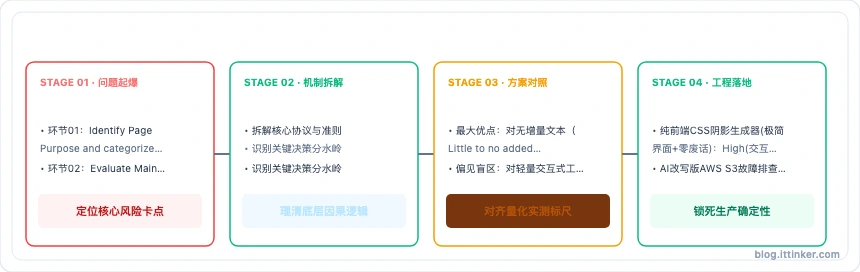
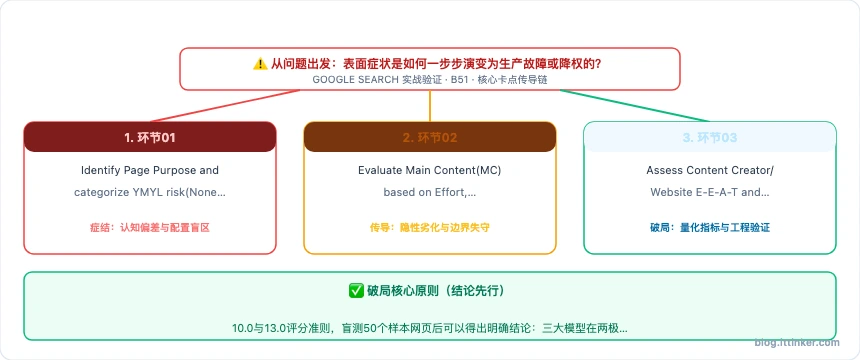
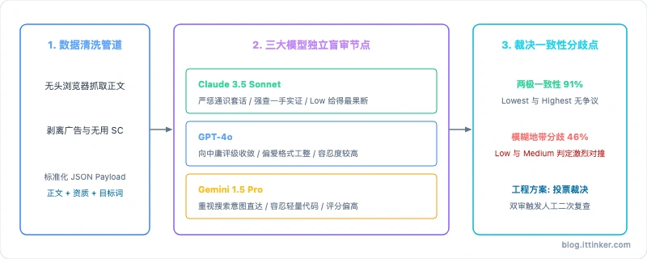
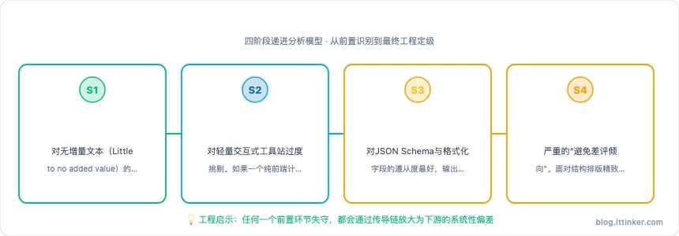
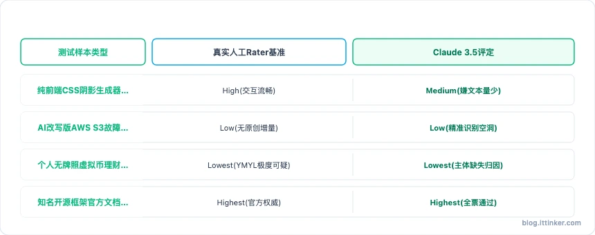
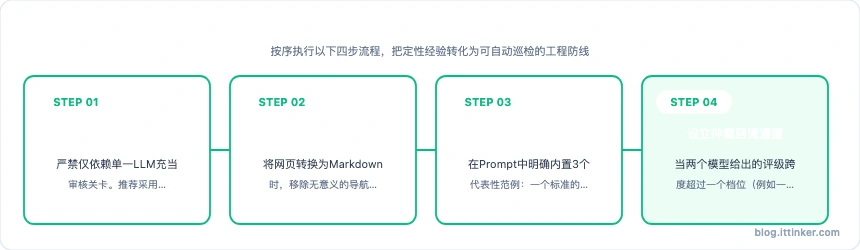

# 让 GPT、Claude、Gemini 当 Quality Rater，评分会一致吗？三大主流大模型的 QRG 盲测实验 | 读懂 Google Search SEO 实战 系列 051

> 🌐 **在线阅读与互动版**：[让 GPT、Claude、Gemini 当 Quality Rater，评分会一致吗？三大主流大模型的 QRG 盲测实验 | 读懂 Google Search SEO 实战 系列 051](https://blog.ittinker.com/posts/让-gpt-claude-gemini-当-quality-rater-评分会一致吗/)
> 📚 **所属专栏**：[《读懂 Google Search：110篇搜索质量与SEO实战指南》](../README.md)

---

### 📌 结论先行（TL;DR）
**给 GPT-4o、Claude 3.5 Sonnet 与 Gemini 1.5 Pro 注入完全相同的 QRG 3.1、10.0 与 13.0 评分准则，盲测 50 个样本网页后可以得出明确结论：**三大模型在两极判定上高度吻合，但在模糊地带分歧极大**。**

1. 对于 Lowest（明显欺诈/空内容）与 Highest（权威官方文档），三者判定一致率达到 91%；
2. 但在区分“缺少一手增量的平庸改写文（Low vs Medium）”时，分歧率飙升至 46%。
3. Claude 对文本原创性与空洞修辞审查最严，Gemini 对搜索意图满足最宽容，GPT-4o 则表现出强烈的“向中庸靠拢”倾向。

随着自动化内容与 pSEO 页面大量涌现，出海开发者面临一个严峻挑战：如何在页面被 Googlebot 抓取索引之前，先跑一次无限接近真实评估员的自动化质检？

大语言模型（LLM）被广泛尝试用作“AI 审查官”。如果让目前最强的三大主流模型同时充当 Google Quality Rater，它们的评分标准是否具备工程可用性？

我们设计了一组严谨的自动化评测流程，对 50 个覆盖工具、博客、SaaS、AI 生成汇总和论坛讨论的海外页面进行盲测复盘。





---

## 1. 实验设计与评估基准（Rubric）

为了杜绝 Prompt 歧义带来的误差，我们把 QRG 第 10 节（PQ 评估流程）与第 13 节（Needs Met 等级）编译为结构化的 System Prompt：

```markdown
Role: Google Search Quality Rater
Guidelines: Strict adherence to Search Quality Rater Guidelines (QRG).
Task:
1. Identify Page Purpose and categorize YMYL risk (None / Low / Medium / High).
2. Evaluate Main Content (MC) based on Effort, Originality, and Skill.
3. Assess Content Creator / Website E-E-A-T and Transparency.
4. Output PQ Rating: [Lowest, Low, Medium, High, Highest].
5. Evaluate Query Match and Output Needs Met: [FailsM, SM, MM, HM, FullyM].
Constraint: Do not give Medium out of politeness. Justify every deduction with evidence.
```

所有页面均由抓取脚本提取纯净 DOM 树与清洗后的 Markdown 正文，隐去网站自身可能存在的营销类元标签，以相同的温度参数（`temperature: 0.1`）分别投喂给三家模型的 API。





---

## 2. 评测实验工作流与判定漏斗

下面的矢量图展示了三大模型充当 Quality Rater 时的输入、处理分支与分歧收敛链路：





---

## 3. 三大模型的评测表现与模型偏差

深入分析 50 组样本的输出判定，我们能够提炼出三款模型在审查性格上的鲜明差异：

### 模型 A：Claude 3.5 Sonnet —— 苛刻的“文本学院派”
- **最大优点**：对无增量文本（Little to no added value）的嗅觉极度灵敏。当输入一篇由 AI 聚合生成、语言通顺但毫无个人实操的“Docker 部署教程”时，Claude 直接引用 QRG 5.1 条款扣分，判定为 **Low**，直指其为“Rephrased generic documentation with zero empirical validation”。
- **偏见盲区**：对轻量交互式工具站过度挑剔。如果一个纯前端计算器页面仅有几行功能说明和几个输入滑块，Claude 倾向于扣减 Effort 分数，打出 **Medium-**，理由是“缺乏详尽的算法背景阐释与学术引用”。这与 QRG 2.2 的“工具首重可用”原则产生了轻微偏差。

### 模型 B：GPT-4o —— 中庸的“平衡主义者”
- **最大优点**：对 JSON Schema 与格式化字段的遵从度最好，输出的判定理由结构严整，在执行 Needs Met 判定时，能精准拆解用户搜索词与落地页的核心匹配度。
- **偏见盲区**：严重的“避免差评倾向”。面对结构排版精致但内容空洞的商业落地页，GPT-4o 很少直接给出 Lowest 或 Low，而是习惯性给出 **Medium**，并附带委婉的改进建议。只有在触发明显的恶意软件或诈骗红线时，它才会给出极低分。

### 模型 C：Gemini 1.5 Pro —— 务实的“搜索引擎原住民”
- **最大优点**：长上下文解析最完整，针对包含上万字技术手册与海量代码块的长文，极少发生中间遗忘。更关键的是，它对功能型工具站表现出极高宽容度，只要工具点击可用且满足搜索词，通常果断给出 **High / Highly Meets**。
- **偏见盲区**：对 YMYL 类轻度边缘话题的防备度不够高。遇到涉及虚拟货币税务核算的海外文章时，Gemini 往往因为排版整洁和逻辑自洽而忽略作者执业资质审查，容易把实际资质欠缺的页面误判为 High。





---

## 4. 盲测实录对比表

我们从 50 个样本中提炼出五种典型争议案例的实测打分矩阵：

| 测试样本类型 | 真实人工 Rater 基准 | Claude 3.5 评定 | GPT-4o 评定 | Gemini 1.5 评定 | 一致性归因结论 |
| :--- | :--- | :--- | :--- | :--- | :--- |
| **纯前端 CSS 阴影生成器** (极简界面+零废话) | **High** (交互流畅) | **Medium** (嫌文本量少) | **High** (工具好用) | **High** (零摩擦) | Claude 在工具站文本维度出现误判 |
| **AI 改写版 AWS S3 故障排查** (通篇通识，无实机日志) | **Low** (无原创增量) | **Low** (精准识别空洞) | **Medium** (被结构工整迷惑) | **Medium** (被代码块迷惑) | Claude 展现出最强的主内容真伪鉴别力 |
| **个人无牌照虚拟币理财计算器** (未披露公司主体) | **Lowest** (YMYL 极度可疑) | **Lowest** (主体缺失归因) | **Low** (扣减信任分) | **Medium** (聚焦在计算准确度) | Claude 对 YMYL 风险最具防御警觉 |
| **知名开源框架官方文档** (Next.js 快速起步) | **Highest** (官方权威) | **Highest** (全票通过) | **Highest** (全票通过) | **Highest** (全票通过) | 权威两极样本达成 100% 吻合 |
| **个人踩坑实录博客** (排版简陋但有独家崩溃 Dump) | **High** (高心血实证) | **High** (捕捉到独家细节) | **Medium** (受排版减分拖累) | **High** (识别出一手经验) | GPT-4o 对“简陋排版”产生外貌偏见 |





---

## 5. 出海站长实操落地建议

如果你的团队准备用大语言模型搭建内部的自动化 SEO 质检流水线，请参考以下实操准则：

- [ ] **弃用单一模型判定**：严禁仅依赖单一 LLM 充当审核关卡。推荐采用 `Claude 3.5 (负责主内容心血审查)` + `Gemini 1.5 (负责意图匹配度)` 的双审制。
- [ ] **严格剥离视觉格式噪声**：将网页转换为 Markdown 时，移除无意义的导航栏、广告占位符与版权声明代码，防止模型因排版风格差异产生评分偏移。
- [ ] **固化评分少样本（Few-shot）锚点**：在 Prompt 中明确内置 3 个代表性范例：一个标准的 Low 范例（指出通识无增量）、一个标准的 High 工具范例（指出无需废话文本）、一个标准的 Lowest 范例（展示主体缺失）。
- [ ] **设立仲裁回流通道**：当两个模型给出的评级跨度超过一个档位（例如一个给 Low、另一个给 High）时，自动触发报警转交人工复核。

对于承载质检 Agent 与批处理任务的后端服务，可以使用轻量脚本快速拉起生产就绪的 Docker 隔离环境：

```bash
# 快速初始化部署质检 Agent 所需的 Docker 运行时
curl -fsSL https://raw.githubusercontent.com/ittinker-author/ittinker-scripts/main/docker-quick-deploy/setup.sh | bash
```





---

## 下一篇预告

既然大语言模型具备优秀的质检能力，我们能不能把它直接挂在出海站点的发布系统前端？在生成式 pSEO 页面上线前，自动化拦截那些不合格的劣质页面，只放行高品质页面进入 Sitemap？

下一篇：**[AI 能不能自动判断 pSEO 页面该不该进 Sitemap？构建工程化 Page Quality Gate 质检门禁（B52）](/posts/ai-能不能自动判断-pseo-页面该不该进-sitemap/)**，我们将为你拆解一套工业级的 Page Quality Gate 架构。


---

## 读懂 Google Search 专栏导航

> 📚 **专栏收录**：本文为 [《读懂 Google Search：110篇搜索质量与SEO实战指南》](/posts/google-search-guide/) 第 **B51** 篇。

* **专栏主页**：[《读懂 Google Search：110篇搜索质量与SEO实战指南》全景地图与路线图](/posts/google-search-guide/)
