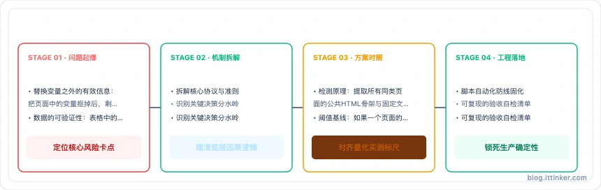
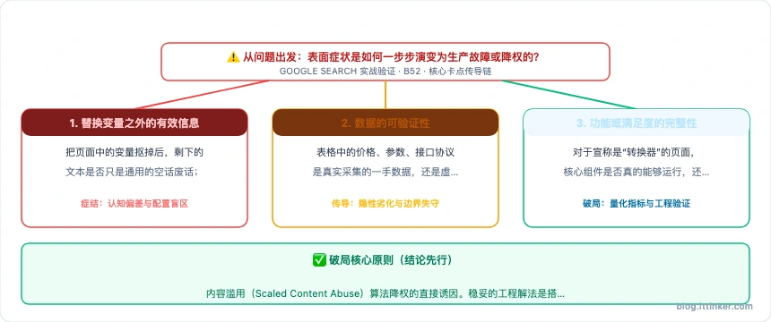
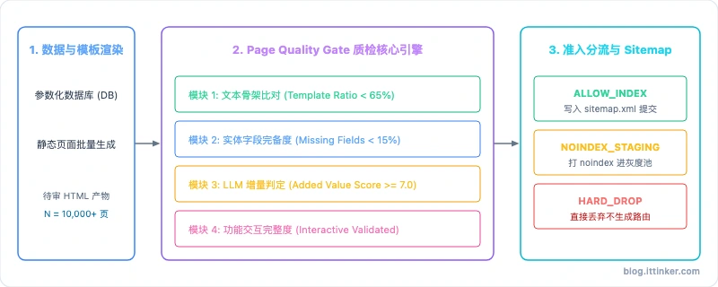
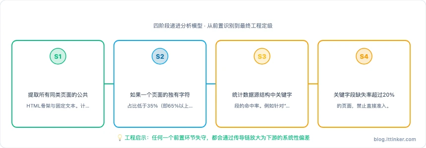
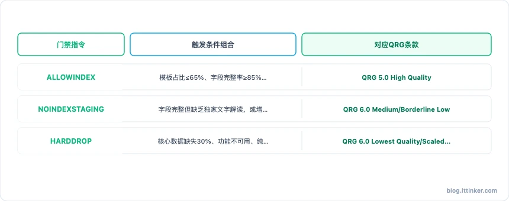
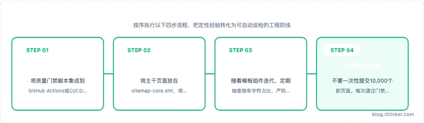

# “几十万页面怎么质检”？用 AI 搭建自动化 PQ Gate 门禁 | 读懂 Google Search SEO 实战 系列 052

> 🌐 **在线阅读与互动版**：[“几十万页面怎么质检”？用 AI 搭建自动化 PQ Gate 门禁 | 读懂 Google Search SEO 实战 系列 052](https://blog.ittinker.com/posts/ai-能不能自动判断-pseo-页面该不该进-sitemap/)
> 📚 **所属专栏**：[《读懂 Google Search：110篇搜索质量与SEO实战指南》](../README.md)

---

### 📌 结论先行（TL;DR）
> **把上万个由模板渲染生成的 pSEO 页面一股脑推进 Sitemap，是触发 Google 规模化内容滥用（Scaled Content Abuse）算法降权的直接诱因。**
> **程序化 SEO（Programmatic SEO, pSEO）是很多独立出海项目获取长尾流量的利器。无论是“Convert [X] to [Y]”的格式转换矩阵，还是“Best alternatives to [Software]”的竞品对比库，其技术本质都是一套页面模板配合结构化数据库进行批量渲染。**
> **这把双刃剑的危险之处在于：当数据源薄弱、字段填充不完整或者模板千篇一律时，自动化流水线会在极短时间内生产数千个只有三两句话差异的空洞网页。**
> **Google 评估指南在第 17 节与第 5.1 节中反复强调：纯靠机械替换占位符、没有带来实质信息增量的页面，属于典型的低质内容。**
> **如果让这些页面直接出现在 XML Sitemap 中，会迅速耗尽站点的抓取预算（Crawl Budget），并拉低整站的质量评估基线。**
> **如何让 AI 担任“守门员”，在生成阶段切断低质页面进入 Sitemap 的通道？**
>
> - 稳妥的工程解法是搭建**上线前门禁（Page Quality Gate）**：在 CI/CD 构建环节接入自动化质检管道，基于 QRG 标准量化计算“模板文本占比”、“实体数据真实度”与“搜索意图增量”，最终分流输出 `ALLOW_INDEX`（准入 Sitemap）、`NOINDEX_STAGING`（灰度观察）与 `HARD_DROP`（阻断发布）三级指令。





---


### 🚨 2026 → 2024 官方最新风向预警：Google 对现代工业级 SEO 自动化质量门禁（Quality Gate Pipelines）的架构演进的策略演进

#### 🕒 2026 → 2024 Google 官方对现代工业级 SEO 自动化质量门禁（Quality Gate Pipelines）的架构演进的策略演进

- **2026 · CI/CD 流水线自动化 Page Quality Gate 全栈架构**
  将 QRG 准则量化为数十个自动化断言与大模型质检节点，在代码部署与页面生成阶段自动化拦截低质、换皮、缺少 Added Value 的长尾页面，从源头杜绝垃圾页面流入生产环境。

- **2025 · Sitemap 动态健康度智能熔断机制**
  系统实时根据各批次页面的收录率与交互数据动态调整准入门槛，收录率一旦出现异常波动立即自动冻结后续 URL 提交，保护整站爬虫信任额度。

- **2024 · 规模化出海团队从‘碰运气 SEO’走向‘确定性工程质量保证’的必然跃迁**
  展示了如何将传统玄学 SEO 彻底改造为符合现代软件工程标准的、具备单元测试与集成门禁的工业级可交付体系。


---


## 1. QRG 规范：规模化内容的低质判定红线

QRG 指南对规模化生产内容的审视，核心集中在是否具备独立增量价值：

> *"Low quality pages often lack an appropriate amount of Main Content (MC) for their purpose, or the MC does not demonstrate adequate effort, originality, talent, or skill. Pages created with little to no original content or added value should be rated Low or Lowest, regardless of whether they were created manually or algorithmically."*
> — **Google QRG 5.1《Inadequate Effort, Originality, Talent, or Skill》**

当评估员面对批量页面时，会迅速核查三个指标：
1. **替换变量之外的有效信息**：把页面中的变量抠掉后，剩下的文本是否只是通用的空话废话；
2. **数据的可验证性**：表格中的价格、参数、接口协议是真实采集的一手数据，还是虚构胡编的随机数；
3. **功能或满足度的完整性**：对于宣称是“转换器”的页面，核心组件是否真的能够运行，还是仅仅放了一个“Coming Soon”的表单骗点击。





---

## 2. Page Quality Gate 自动化质检架构

下面的矢量架构图展示了工程化 Page Quality Gate 的流水线作业流程：





---

## 3. 五维量化打分模型与执行逻辑

为了将主观的 QRG 评语翻译为程序可处理的量化规则，我们在门禁引擎中设置了五个维度的加权公式：

### 1. 模板占空比（Template Footprint Ratio）
- **检测原理**：提取所有同类页面的公共 HTML 骨架与固定文本。计算页面独有内容字符数与全页总字符数的比值。
- **阈值基线**：如果一个页面的独有字符占比低于 35%（即 65% 以上全是所有页面共享的公共模板文字），判定为 **High Template Risk**。

### 2. 实体数据丰度（Entity Data Completeness）
- **检测原理**：统计数据源结构中关键字段的命中率。例如针对“数据库选型页面”，核查 `benchmark_latency`、`pricing_tier`、`license_type` 等 8 个核心参数。
- **阈值基线**：关键字段缺失率超过 20% 的页面，禁止直接准入。

### 3. LLM 增量判定（Added Value Score）
- **检测原理**：利用 LLM 将当前页面生成的文本与该关键词在 Google Top 3 的基础通识摘要做交叉对比，要求大模型专门回答：“本页面是否提供了 Top 3 搜索结果中未曾提及的具体配置参数、独家代码片段或真实对比结论？”
- **阈值基线**：满分 10 分，评分低于 7.0 的页面直接打入待补充队列。

### 4. 交互式功能真实性（Functional Integrity）
- **检测原理**：利用 Playwright 或 Puppeteer 运行无头测试，模拟用户点击按钮与提交表单。
- **阈值基线**：页面中如果包含不可交互的伪按钮、无法运行的死代码块，直接标记为 Lowest Quality。





---

## 4. 生产环境门禁决策代码范例

以下是用 Node.js 编写的轻量质检流水线脚本示例，用于在生成静态 Sitemap 前执行过滤：

```javascript
// quality-gate-filter.mjs
import fs from 'node:fs';

export async function evaluatePseoPage(pageData) {
  const { title, templateRatio, entityMissingRate, llmAddedValueScore, isFunctional } = pageData;

  // 1. 致命缺陷排查 (QRG 6.0 Lowest Standards)
  if (!isFunctional) {
    return { decision: 'HARD_DROP', reason: 'Non-functional interactive elements detected' };
  }

  // 2. 模板占空比与字段缺失严重超标
  if (templateRatio > 0.70 || entityMissingRate > 0.30) {
    return { decision: 'HARD_DROP', reason: 'High boilerplate ratio or severe data shortage' };
  }

  // 3. 缺乏实质信息增量 (QRG 5.1 Low Effort)
  if (llmAddedValueScore < 6.5) {
    return { decision: 'NOINDEX_STAGING', reason: 'Marginal added value compared to SERP baselines' };
  }

  // 4. 优质合格页面，允许进索引
  return {
    decision: 'ALLOW_INDEX',
    reason: 'Solid entity data, low template footprint, and proven added value'
  };
}
```


---

## 5. 准入决策状态对照表

| 门禁指令 | 触发条件组合 | 对应 QRG 条款 | Sitemap 行为 | 页面 Meta 标签设置 |
| :--- | :--- | :--- | :--- | :--- |
| **`ALLOW_INDEX`** | 模板占比 ≤ 65%、字段完整率 ≥ 85%、增量分 ≥ 7.0、交互功能正常 | QRG 5.0 High Quality | **写入 `sitemap.xml`** | `<meta name="robots" content="index, follow">` |
| **`NOINDEX_STAGING`** | 字段完整但缺乏独家文字解读，或增量分在 5.0~6.9 之间 | QRG 6.0 Medium / Borderline Low | **移出 Sitemap** | `<meta name="robots" content="noindex, follow">` |
| **`HARD_DROP`** | 核心数据缺失 > 30%、功能不可用、纯属通识重写 | QRG 6.0 Lowest Quality / Scaled Abuse | **完全不生成路由** | 直接从构建流程中剔除，不消耗服务器资源 |





---

## 6. 出海站长实操自查清单

在启动大规模 pSEO 批量页面生成时，务必落实以下规范：

- [ ] **设立构建时质检闸口**：将质量门禁脚本集成到 GitHub Actions 或 CI/CD 流水线中，禁止未经门禁跑分的页面直通生产。
- [ ] **多 Sitemap 分池管理**：将主干页面放在 `sitemap-core.xml`，将 pSEO 页面放在 `sitemap-pseo-v1.xml`。一旦发生异常波动，能迅速隔离特定子集。
- [ ] **动态监控模板占空比**：随着模板组件迭代，定期抽查独有字符占比，严防因为公用 Header/Footer 扩充导致独有内容稀释。
- [ ] **灰度放行机制**：不要一次性提交 10,000 个新页面。每次通过门禁后，以每周 300-500 页的节奏分批纳入 Sitemap，观察 GSC 抓取率与索引转化率。
- [ ] **定期清理僵尸灰度页**：在 Staging 池中超过 60 天仍未补充实证数据的页面，果断执行彻底清除。

针对需要高可靠部署自动化静态页面构建与定时校验任务的场景，建议配合轻量部署脚本进行容器化托管：

```bash
# 部署包含无头浏览器测试环境的 Docker 基础镜像
curl -fsSL https://raw.githubusercontent.com/ittinker-author/ittinker-scripts/main/docker-quick-deploy/setup.sh | bash
```





---

## 下一篇预告

建立了上线前的页面品质门禁后，线上真实的竞争环境又是怎样的？如果我们挑选一个真实的高价值业务搜索词，把 Google SERP 第一页排名前 10 的网页全部拿出来，严格按照 QRG 的 Needs Met 标准重新打一次分，会看到什么意想不到的现象？

下一篇：**[“Google 的真实排名和自己的评分标准差了多少”？实锤数据的拷问：我把 SERP Top 10 全部按 Needs Met 重打一次分！（B53）](/posts/我把-serp-top-10-全部按-needs-met-重打一次分/)**，我们将为你揭开算法排名与人工评估打分之间的微妙偏差。


---

## 读懂 Google Search 专栏导航

> 📚 **专栏收录**：本文为 [《读懂 Google Search：110篇搜索质量与SEO实战指南》](/posts/google-search-guide/) 第 **B52** 篇。

* **专栏主页**：[《读懂 Google Search：110篇搜索质量与SEO实战指南》全景地图与路线图](/posts/google-search-guide/)
