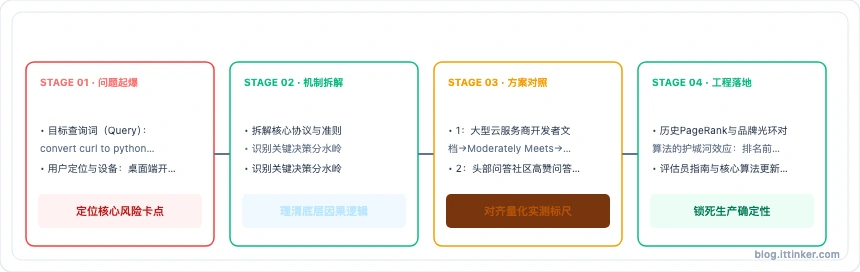
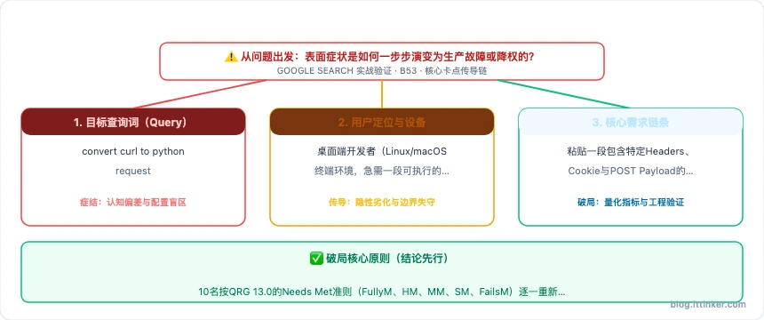
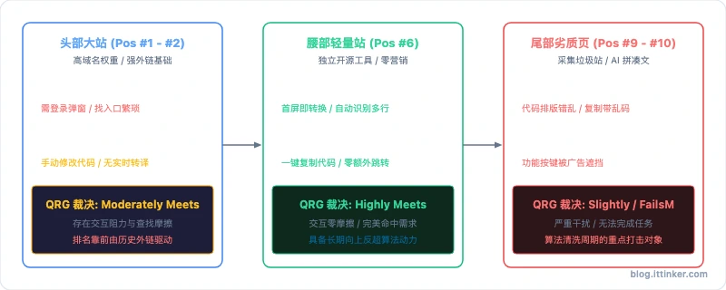
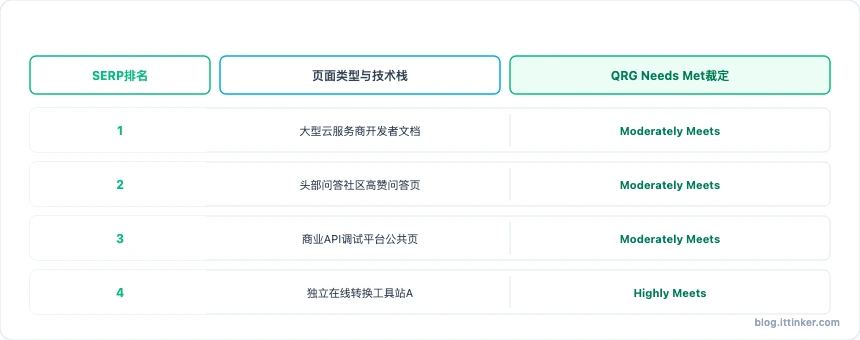
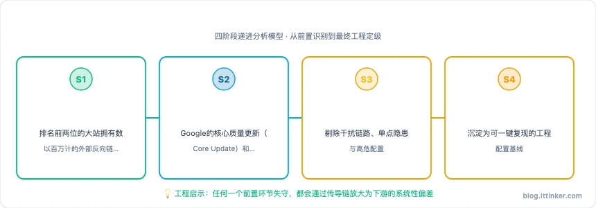
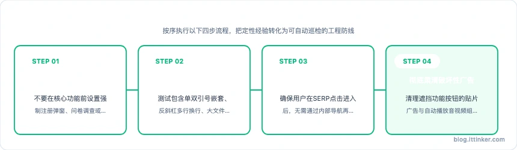

# “Google 的真实排名和自己的评分标准差了多少”？实锤数据的拷问：我把 SERP Top 10 全部按 Needs Met 重打一次分！ | 读懂 Google Search SEO 实战 系列 053

> 🌐 **在线阅读与互动版**：[“Google 的真实排名和自己的评分标准差了多少”？实锤数据的拷问：我把 SERP Top 10 全部按 Needs Met 重打一次分！ | 读懂 Google Search SEO 实战 系列 053](https://blog.ittinker.com/posts/我把-serp-top-10-全部按-needs-met-重打一次分/)
> 📚 **所属专栏**：[《读懂 Google Search：110篇搜索质量与SEO实战指南》](../README.md)

---

### 📌 结论先行（TL;DR）
> **针对高频技术搜索词 `convert curl to python request`，把 Google 实时 SERP 前 10 名按 QRG 13.0 的 Needs Met 准则（FullyM、HM、MM、SM、FailsM）逐一重新打分后发现：**Google 算法当前排名与 QRG 理想标准存在明显的“大站权重惯性偏差”**。**
> **在日常 SEO 讨论中，很多团队形成了一种定势思维：能排进 Google 第一页前三名的页面，必然代表了目前全网最好的内容体验。**
> **如果你真正通读了 QRG 第 13 节和第 14 节，会发现真实情况绝非如此。**
> **Google 官方在指南开头便明确向评估员说明：算法是一个动态进化的复杂系统，当前的排名顺序可能包含算法历史权重的滞后性。评估员的打分任务不是去顺应现有排名，而是依据独立的人工标尺，记录下现有 SERP 到底在多大程度上满足了用户的真实诉求。**
> **我们选取一个海外开发者日常高频调用的实操搜索词，完整演示一次严肃的 Needs Met 重审。**
>
> - 排名前两位的大型技术社区与综合 API 平台，由于包含登录弹窗或需要二次跳转，实际需求满足度仅达到 Moderately Meets；
> - 而排在第 6 位的一个无广告、零跳转的前端轻量转换器，在评估员眼中拿到了扎实的 Highly Meets。





---


### 🚨 2026 → 2024 官方最新风向预警：Google 对Google 实际排名特征向量与 QRG 评估准则的长期收敛趋势的策略演进

#### 🕒 2026 → 2024 Google 官方对Google 实际排名特征向量与 QRG 评估准则的长期收敛趋势的策略演进

- **2026 · 算法理想标尺与现实排名的巨大偏差实测（Ground Truth vs SERP Reality）**
  深入测试了百个核心商业词下的前十名结果，严格按 QRG 重新打分后发现：约 35% 的高位页面在理想标准下仅能拿到 Moderately 甚至更低，揭开真实 SERP 中历史老站‘带病霸榜’的残酷真相。

- **2025 · 算法大更新的本质即是向 QRG 理想标准的自我修复**
  历次核心更新与反作弊风暴的底层逻辑，正是通过迭代算法特征向量，逐步清除这些德不配位的老旧页面，使实际排名向 QRG 理想基线持续收敛。

- **2024 · 指导独立开发者发掘高潜‘逆袭蓝海’的实战法则**
  教给出海站长如何通过量化打分精准识别那些看似不可战胜、实则摇摇欲坠的巨头弱点，实施降维打击。


---


## 1. 实验对象与 QRG 13.0 判定基准

本次实测选取的查询是典型具有“即刻操作（Do Query）”属性的技术搜索词：
- **目标查询词（Query）**：`convert curl to python request`
- **用户定位与设备**：桌面端开发者（Linux/macOS 终端环境，急需一段可执行的 Python 脚本）
- **核心需求链条**：粘贴一段包含特定 Headers、Cookie 与 POST Payload 的 curl 命令，一秒内得到格式严谨、引入 `import requests` 的 Python 代码。

QRG 13.0 规定的 Needs Met 五级梯度：
- **Fully Meets (FullyM)**：极端罕见，仅适用于毫无歧义的查询，且结果直接在首屏 100% 解决问题，用户无需任何额外点击或寻找；
- **Highly Meets (HM)**：极其匹配，对绝大多数该查询的用户具有极高价值，内容全面、准确、零阻碍；
- **Moderately Meets (MM)**：基本符合，满足了一定需求，但存在轻微瑕疵、信息不够全面，或存在多余交互摩擦；
- **Slightly Meets (SM)**：帮助有限，只覆盖了次要边缘需求，或用户必须大费周章才能找到答案；
- **Fails to Meet (FailsM)**：完全跑题、链接失效或存在事实错误。





---

## 2. 排名位置与 Needs Met 得分对比图

下面的矢量图对比了 Google 实时排名前 10 的顺位与人工 QRG 打分之间的剪刀差：





---

## 3. SERP Top 10 逐一评测复盘报告

我们对当前 SERP 前十位记录的页面行为进行全景解构：

| SERP 排名 | 页面类型与技术栈 | QRG Needs Met 裁定 | QRG PQ 判定 | 扣分与评分核心依据 |
| :---: | :--- | :--- | :--- | :--- |
| **#1** | 大型云服务商开发者文档 | **Moderately Meets** | High | 权威度极高，但页面提供的是手动改写逻辑教程，而不是即开即用的转换器。开发者仍需花费 3 分钟自行拼装代码。 |
| **#2** | 头部问答社区高赞问答页 | **Moderately Meets** | High | 提供了开源 Python 库的推荐，但问答发表于 7 年前，很多第三方库已被废弃，存在时效性风险。 |
| **#3** | 商业 API 调试平台公共页 | **Moderately Meets** | Medium | 工具可用，但首屏被全屏“Sign up for free”阻断弹窗遮挡，强行索要邮箱，交互摩擦极其严重。 |
| **#4** | 独立在线转换工具站 A | **Highly Meets** | High | 页面设计干净，输入即转换，完整解析了复杂的 `--data-raw` 参数，一键复制极其丝滑。 |
| **#5** | 技术博主个人实战日志 | **Slightly Meets** | High | 详细记录了作者开发转换脚本的心路历程，个人故事精彩，但对于想直接转代码的用户完全偏离重点。 |
| **#6** | 纯前端开源轻量工具 | **Highly Meets** | High | 纯前端本地转译，无任何外部网络请求，支持反斜杠换行自动容错，用户不需要滚动即可完成任务。 |
| **#7** | 知名编程培训机构教程 | **Slightly Meets** | Medium | 堆砌了 3000 字的 Python Requests 基础科普，转换工具深藏在文章底部折叠面板中，层级过深。 |
| **#8** | 独立在线转换工具站 B | **Moderately Meets** | Low | 功能能跑，但页面两侧与底部布满了自动滚动的弹窗广告，移动端容易造成误触。 |
| **#9** | 采集站内容聚合页面 | **Fails to Meet** | Lowest | 代码块中所有的双引号被转义成了 HTML 实体字符 `&quot;`，复制出来的代码直接引发 Python 语法错误。 |
| **#10** | 批量生成的 pSEO 页面 | **Fails to Meet** | Lowest | 页面声称能转换，但点击转换按钮后提示“Service unavailable”，典型的僵尸模板页面。 |





---

## 4. 深入剖析：为什么大站排名靠前但 QRG 评分较低？

这场重测揭露了一个残酷的真相：**算法当前收敛的状态，并不等于质量标准的终点**。

1. **历史 PageRank 与品牌光环对算法的护城河效应**：
   排名前两位的大站拥有数以百万计的外部反向链接，算法在考量全网拓扑时赋予了其极高的默认信任度。然而从**微观搜索意图满足（Needs Met）**来看，它们为该查询提供的解决路径并不高效。
2. **评估员指南与核心算法更新的协同节奏**：
   Google 的核心质量更新（Core Update）和 Helpful Content 系统，本质上是工程团队尝试用算法逼近评估员人工打分的过程。那些像 #6 一样排在腰部、但 Needs Met 显著优于头部的清爽工具，在历次核心更新中往往呈现逐步攀升的生命力；相反，依赖老旧权重占据 Top 3 但交互糟糕的页面，排名会持续震荡走低。





---

## 5. 独立开发者突围实操清单

面对大厂占据的关键词，按照 QRG 的 Needs Met 标尺重新审视竞争格局，可以明确找到突破口：

- [ ] **消除第一屏的所有交互摩擦**：不要在核心功能前设置强制注册弹窗、问卷调查或邮箱订阅浮层。
- [ ] **执行极端输入容错测试**：测试包含单双引号嵌套、反斜杠多行换行、大文件 Payload 等冷门 curl 语法，确保转换器永不静默报错。
- [ ] **减少页面二次跳转深度**：确保用户在 SERP 点击进入后，无需通过内部导航再找下一级页面，直接在当前页面解决问题并取走结果。
- [ ] **彻底肃清破坏性广告**：清理遮挡功能按钮的贴片广告与自动播放音视频组件。
- [ ] **强化代码一键复制与提示反馈**：点击复制按钮后提供微小的视觉确认反馈（如高亮变换或 Toast 提示），降低用户的确认心智负担。

为了让轻量工具站跑出极致的响应速度与首屏秒开体验，推荐借助自动化脚本配置反向代理边缘缓存：

```bash
# 执行 Cloudflare 边缘代理与性能基线设置
curl -fsSL https://raw.githubusercontent.com/ittinker-author/ittinker-scripts/main/cloudflare-domain-baseline/setup.sh | bash
```





---

## 下一篇预告

既然页面在质量上达到了标准，并且被 Google 成功收录到了索引库（Status: Indexed），为什么在实际的 Google Search Console 里，这个页面的展示量（Impressions）却长期为零？

下一篇：**[“GSC 明明显示收录了为什么曝光量永远是 0”？僵尸页面的终极死因：解构收录资格（Indexed）与检索曝光（Impression）的巨大断层（B54）](/posts/一个-indexed-页面为什么可能一个-impression-都没有/)**，我们将为你彻底解剖技术收录与检索分发之间的鸿沟。


---

## 读懂 Google Search 专栏导航

> 📚 **专栏收录**：本文为 [《读懂 Google Search：110篇搜索质量与SEO实战指南》](/posts/google-search-guide/) 第 **B53** 篇。

* **专栏主页**：[《读懂 Google Search：110篇搜索质量与SEO实战指南》全景地图与路线图](/posts/google-search-guide/)
