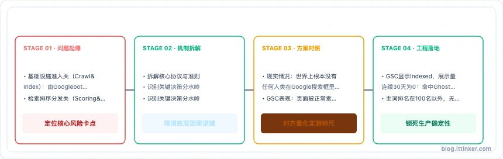
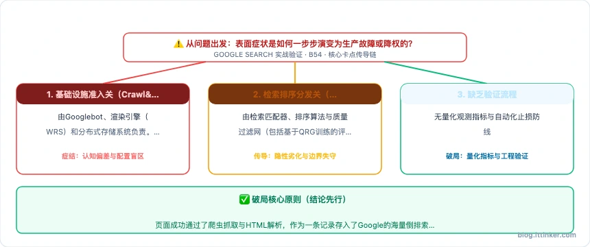
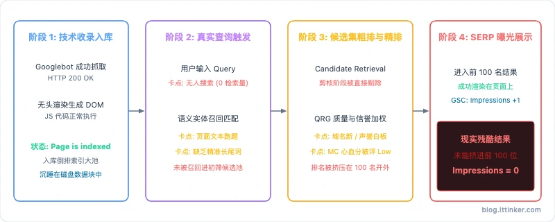
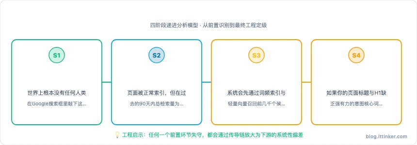
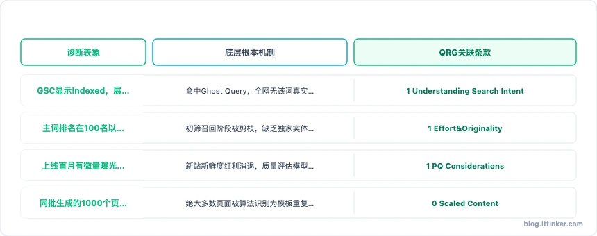
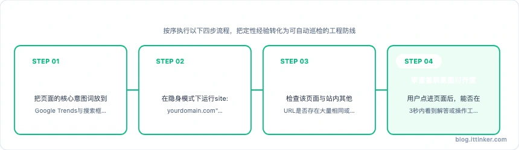

# “GSC 明明显示收录了为什么曝光量永远是 0”？僵尸页面的终极死因：解构收录资格（Indexed）与检索曝光（Impression）的巨大断层 | 读懂 Google Search SEO 实战 系列 054

> 🌐 **在线阅读与互动版**：[“GSC 明明显示收录了为什么曝光量永远是 0”？僵尸页面的终极死因：解构收录资格（Indexed）与检索曝光（Impression）的巨大断层 | 读懂 Google Search SEO 实战 系列 054](https://blog.ittinker.com/posts/一个-indexed-页面为什么可能一个-impression-都没有/)
> 📚 **所属专栏**：[《读懂 Google Search：110篇搜索质量与SEO实战指南》](../README.md)

---

### 📌 结论先行（TL;DR）
> **Google Search Console 提示“Page is indexed（已编入索引）”，只代表该页面成功通过了爬虫抓取与 HTML 解析，作为一条记录存入了 Google 的海量倒排索引库。**
> **许多出海站长在查看 Google Search Console（GSC）的页面索引报告时，常常陷入一种巨大的落差：几百甚至上千个页面明明已经被打上了绿色的“Indexed”标记，但在“效果（Performance）”报告中，这些 URL 的展示次数（Total Impressions）在连续两三个月内始终是醒目的数字 `0`。**
> **很多人因此怀疑是 GSC 数据延迟，或者是 Googlebot 判定算法出现了缓存 Bug。**
> **如果你从 Google 搜索引擎的信息检索（IR）工程架构与 QRG 的质量过滤机制来审视，就会发现这种现象完全处于系统的设计预期之中。**
>
> - **技术收录仅仅是获得了排队的参赛证**：绝不承诺任何搜索展示（Impressions）**。
> - **页面遭遇零曝光的核心根源通常有四点**：命中无人搜索的虚无伪意图（Ghost Query）、初筛候选集阶段（Retrieval）被剪枝过滤、综合质量分未达到前 100 位展示配额门槛，或内容与目标词意图产生了结构性错位。





---


### 🚨 2026 → 2024 官方最新风向预警：Google 对Google 索引库分层存储（Two-tier Indexing）与曝光阈值的算法演进的策略演进

#### 🕒 2026 → 2024 Google 官方对Google 索引库分层存储（Two-tier Indexing）与曝光阈值的算法演进的策略演进

- **2026 · 两级索引库分层架构揭秘（Serving Tier vs Cold Storage）**
  Googlebot 将收录划分为‘高优先级检索层（Serving Tier）’与‘底层冷备份库（Cold Storage）’。质量仅及格的页面虽显示被收录，但被永久锁死在冷库中，永远无法在真实用户搜索中获得曝光展示。

- **2025 · 零曝光（Zero Impressions）四步逆向诊断与破局 SOP**
  系统化梳理页面从冷库激活至热检索层的核心动作：重塑首屏第一手实证、剔除注水废话、注入真实外部交互信号与构建精准内链网络。

- **2024 · QRG 准则在唤醒沉睡僵尸资产中的药引作用**
  指导站长不要盲目重复生成新页面，把现有‘已收录但无曝光’的沉默资产进行精细化手术式改造，往往能以最小成本换取最大流量爆发。


---


## 1. 概念解耦：Crawl/Index 与 Search Serving 的本质区别

Google 官方技术文档与 QRG 之间存在一条明确的分工界线：

> *"Crawling and indexing are technical processes where Google discovers, renders, and stores pages. However, having a page in the index does not guarantee it will be shown in search results. Serving search results depends on relevance to the specific query, page quality, and user satisfaction signals."*
> — **Google Search Central Documentation & QRG 3.0 Alignment**

这表明从 URL 被抓取到最终在用户的屏幕上生成一次 Impression，必须跨越两道性质完全不同的关卡：
1. **基础设施准入关（Crawl & Index）**：由 Googlebot、渲染引擎（WRS）和分布式存储系统负责。只要页面能返回 HTTP 200、没有 `noindex`、没有引发严重超时，且服务器能承载抓取，页面就能进入倒排索引库（Inverted Index）；
2. **检索排序分发关（Scoring & Serving）**：由检索匹配器、排序算法与质量过滤网（包括基于 QRG 训练的评分系统）动态决定。只有当用户发起的真实查询触发了召回，且该页面的综合得分挤进 SERP 前 100 位时，GSC 才会记录下 1 次展示。





---

## 2. 从入库到展示的断层漏斗图

下面的矢量图清晰揭示了技术收录与真实曝光之间的多层衰减漏斗：





---

## 3. 四大核心断裂深水区

为什么一个网页进了库，却死活换不来曝光？我们将其归结为四个工程原因：

### 1. 虚构需求陷阱：Ghost Query（幽灵词）
许多 pSEO 站长通过三元组笛卡尔积批量拼接标题，例如生成了 `best-redis-cache-for-haskell-in-iceland`（冰岛地区适用于 Haskell 的最佳 Redis 缓存）。
- **现实情况**：世界上根本没有任何人类在 Google 搜索框里敲下这串词。
- **GSC 表现**：页面被正常索引，但在过去的 90 天内总检索量为零。没有用户搜索，当然产生不了任何 Impression。

### 2. 候选集检索（Retrieval）初筛剪枝
Google 每天要处理上百亿次搜索请求。面对一个高频词，检索系统不可能实时对数亿个已收录页面逐个运行复杂的深度神经网络重排。
- **倒排索引修剪**：系统会先通过词频索引与轻量向量召回前几千个候选网页（Candidates）。
- **淘汰原因**：如果你的页面标题与 H1 缺乏强有力的意图核心词，或者正文缺乏核心实体关联，页面会在百毫秒级的初筛阶段被直接裁剪，根本没有资格进入后端的质量精排环节。

### 3. GSC 统计物理界限：未进 Top 100 的隐形淘汰
许多站长不知道 Google Search Console 记录 Impression 的统计学边界：
- **GSC 官方展示规则**：只有当一个 URL 在用户搜索产生的 SERP 中实际加载出来时（通常桌面端最多翻页至第 10 页，即前 100 个结果；移动端连续滚动通常也截断在前 100-150 个条目），系统才会为该 URL 计入一次 Impression。
- **现实情况**：如果你的页面在当前关键词下的实时排位是第 142 名，即使用户输入了完全一致的关键词，因为用户根本翻不到这么深，你的页面在 GSC 统计表中依然是坚挺的 `0`。

### 4. QRG 质量折价：冷冻惩罚机制
如果你的页面被评估模型识别出以下 QRG 减分特征：
- 缺乏明确的作者背景与联系方式（QRG 2.5）；
- 文本完全是常见常识的翻版重写，没有任何原创测试与独家数据（QRG 5.1）；
- 页面充斥大量模板空骨架。
这类页面虽然因为服务器没有阻拦而被收录入库，但会被算法打上低优先级标签，压制在 SERP 极深处，处于“已收录但被事实冷冻”的状态。





---

## 4. 零曝光诊断与对照表

| 诊断表象 | 底层根本机制 | QRG 关联条款 | 验证核查动作 | 救赎整改策略 |
| :--- | :--- | :--- | :--- | :--- |
| **GSC 显示 Indexed，展示量连续 30 天为 0** | 命中 Ghost Query，全网无该词真实检索需求 | 12.1 Understanding Search Intent | 查阅 Google Keyword Planner 或 Ahrefs 是否有历史检索量 | 重构 URL 组合逻辑，向真实有搜索量的主词靠拢 |
| **主词排名在 100 名以外，无任何长尾触发** | 初筛召回阶段被剪枝，缺乏独家实体与高权重共现词 | 5.1 Effort & Originality | 检查页面是否只覆盖了通识，缺少具体的版本号与代码实证 | 补充一手代码报错复现、详细配置文件或基准测试图表 |
| **上线首月有微量曝光，随后跌落至 0** | 新站新鲜度红利消退，质量评估模型完成定级降级 | 3.1 PQ Considerations | 审查跳出率、停留时长与页面交互是否存在严重摩擦 | 消除阻断性广告弹窗，精简首屏多余文字，直达操作功能 |
| **同批生成的 1000 个页面只有 3 个有曝光** | 绝大多数页面被算法识别为模板重复页（Near-duplicate） | 17.0 Scaled Content | 计算页面间 Jaccard 文本相似度与模板占空比 | 大幅删减薄弱页面，将数据合并为更具深度的大页面 |





---

## 5. 出海站长实操自查清单

排查已收录页面的零曝光问题时，请遵循以下诊断流：

- [ ] **验证目标词真实搜索体量**：把页面的核心意图词放到 Google Trends 与搜索框中，查看 Google 自动补全建议（Autocomplete）。如果完全没有任何联想词，说明目标需求可能并不真实存在。
- [ ] **执行现场 SERP 穿透查询**：在隐身模式下运行 `site:yourdomain.com "target query keyword"`，确认 Google 是否把该页面列入该词的本站首要匹配页。
- [ ] **排查近重复内容（Near-duplicate）**：检查该页面与站内其他 URL 是否存在大量相同或高度近似的段落，严防站内自我竞争与互相抵消。
- [ ] **审查首屏意图对齐度**：用户点进页面后，能否在 3 秒内看到解答或操作工具，杜绝将核心答案藏在深层折叠组件内。
- [ ] **建立定期死页清理流程**：对于已收录超过 90 天且持续零曝光的纯模板页面，果断打上 `noindex` 或执行 410 Gone 删除，回收抓取预算。

针对出海服务的高并发反向代理与长尾请求分析，可以使用脚本对服务网关进行健康追踪与日志审计：

```bash
# 检查服务器资源开销与网络连接状态
curl -fsSL https://raw.githubusercontent.com/ittinker-author/ittinker-scripts/main/vps-health-monitor/install.sh | bash
```





---

## 下一篇预告

既然成批生成的页面可能遭遇零曝光，那么当批量上线 100 个 pSEO 页面后，我们应该在什么时间节点介入评估？用哪些具体的度量指标，来决定是继续放量铺开，还是果断按下终止键？

下一篇：**[“100 个页面上线后到底该继续砸钱还是认赔离场”？拒绝沉没成本：用带证伪红线的止损决策模型指导 pSEO 迭代（B55）](/posts/100-个-pseo-页面上线后-我会用哪些指标决定继续还是停止/)**，我们将为你梳理一套带 Review Date 与证伪红线的止损决策模型。


---

## 读懂 Google Search 专栏导航

> 📚 **专栏收录**：本文为 [《读懂 Google Search：110篇搜索质量与SEO实战指南》](/posts/google-search-guide/) 第 **B54** 篇。

* **专栏主页**：[《读懂 Google Search：110篇搜索质量与SEO实战指南》全景地图与路线图](/posts/google-search-guide/)
