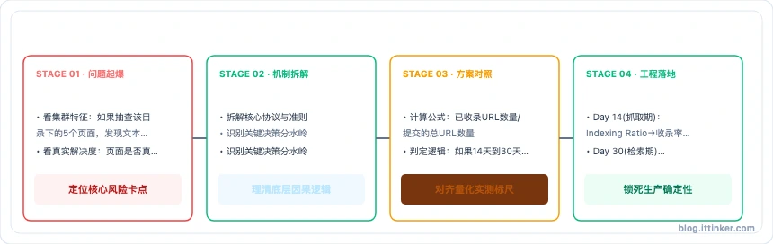
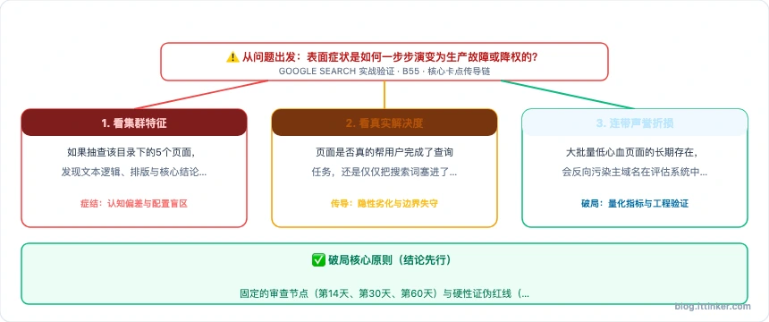
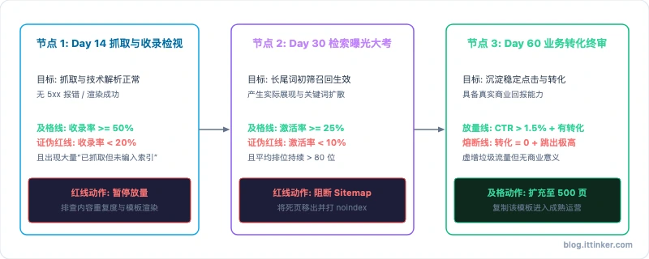
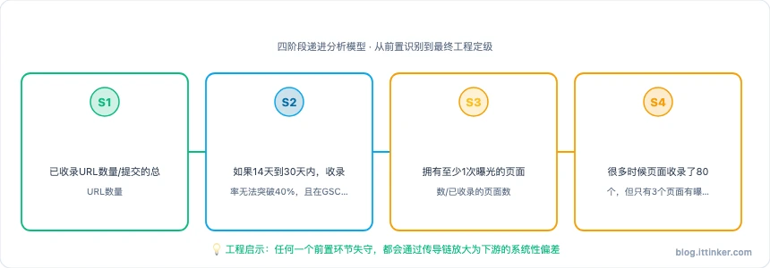
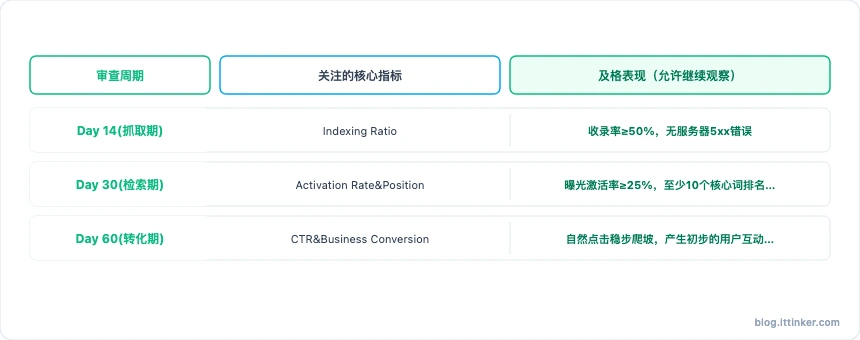
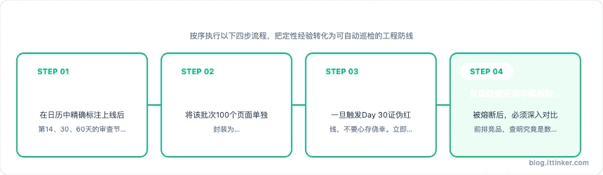

# “一百个页面上线后继续还是止损”？带证伪红线的 pSEO 迭代模型 | 读懂 Google Search SEO 实战 系列 055

> 🌐 **在线阅读与互动版**：[“一百个页面上线后继续还是止损”？带证伪红线的 pSEO 迭代模型 | 读懂 Google Search SEO 实战 系列 055](https://blog.ittinker.com/posts/100-个-pseo-页面上线后-我会用哪些指标决定继续还是停止/)
> 📚 **所属专栏**：[《读懂 Google Search：110篇搜索质量与SEO实战指南》](../README.md)

---

### 📌 结论先行（TL;DR）
> **批量上线 100 个 pSEO 实验页面后，绝不能无限期被动等待，必须在上线当天就锁死**固定的审查节点（第 14 天、第 30 天、第 60 天）与硬性证伪红线（Kill-Switch）**。**
> **在出海开发过程中，很多团队把程序化 SEO 当成一场只管“踩油门”的无本买卖。写好一套静态渲染脚本，从数据库里抓取 100 个长尾词，生成页面并提交到 Sitemap，之后就听天由命。**
> **更糟糕的情况是：当页面表现疲软时，站长不仅不反思模板质量与意图匹配度，反而迷信“量变引起质变”，继续铺开 1,000 个甚至 10,000 个页面。**
> **在 Google QRG 第 17 节的“规模化内容滥用（Scaled Content Abuse）”审查逻辑下，这种行为会迅速把整个域名推向灾难边缘。**
> **科学的做法是将每一批 pSEO 实验看作一个具备**可证伪性（Falsifiable）**的技术假设，用严密的指标看板与明确的止损开关管理整个生命周期。**
>
> - **如果上线 30 天后**：收录率低于 35%、产生真实曝光的页面占比低于 15%，或者展示词平均排名死锁在 75 名开外，表明该批模板已触发 Google 低质算法抑制。
> - **此时必须立即执行熔断下线**：批量注入 `noindex` 隔离，严防低质内容稀释整站权重。





---


### 🚨 2026 → 2024 官方最新风向预警：Google 对Google 流量爬坡周期（30-90天观察期）与程序化项目止损标尺演进的策略演进

#### 🕒 2026 → 2024 Google 官方对Google 流量爬坡周期（30-90天观察期）与程序化项目止损标尺演进的策略演进

- **2026 · 科学止损与证伪红线决策模型（Falsifiable Stop-loss Model）**
  为出海 pSEO 与产品矩阵项目制定清晰的 30/60/90 天里程碑红线：收录率未破 40%、平均排名停滞在 30 名外、跳出率高于 80% 即刻触发熔断，杜绝无意义的沉没成本堆积。

- **2025 · 数据驱动的迭代方向修正（Data-driven Pivot SOP）**
  当触发警告红线时，系统化排查是选词错误、形态错配还是质量稀薄，帮助团队快速决定是优化模板还是彻底关停换道。

- **2024 · 现代敏捷独立开发者的精益 SEO 生存哲学**
  倡导小步快跑、快速验证、果断止损的现代创业观，打破‘只要坚持更新就一定会好起来’的盲目毒鸡汤。


---


## 1. QRG 规范：规模化内容的质量审查红线

QRG 指南对规模化页面的审视原则清晰明确：

> *"When many pages are created with low effort, little added value, or without regard to whether the content actually meets user needs, it harms the overall quality of search results. Evaluators must look for patterns of low-effort automation across the entire domain."*
> — **Google QRG 17.0《Scaled Abuse and Low Quality Automation》**

评估员在审查成批页面时，遵循三条铁律：
1. **看集群特征**：如果抽查该目录下的 5 个页面，发现文本逻辑、排版与核心结论 90% 完全雷同，整批页面会被统一下调评级；
2. **看真实解决度**：页面是否真的帮用户完成了查询任务，还是仅仅把搜索词塞进了标题；
3. **连带声誉折损**：大批量低心血页面的长期存在，会反向污染主域名在评估系统中的整体信任底座。





---

## 2. 14/30/60 天审查决策看板

下面的矢量图展示了 pSEO 批次发布后的三级审查时间窗口与熔断分流支路：





---

## 3. 决定继续还是停止的五大硬核指标

我们不看花哨的第三方工具跑分，只盯五个紧贴 Google 核心链路与商业转化的原生数据：

### 指标 1：收录转化率（Indexing Ratio）
- **计算公式**：`已收录 URL 数量 / 提交的总 URL 数量`
- **判定逻辑**：如果 14 天到 30 天内，收录率无法突破 40%，且在 GSC 中大量堆积“Discovered - currently not indexed（已发现 - 尚未编入索引）”，这是 Googlebot 认为站点整体抓取优先级过低或内容质量存疑的直接信号。

### 指标 2：曝光激活率（Impression Activation Rate）
- **计算公式**：`拥有至少 1 次曝光的页面数 / 已收录的页面数`
- **判定逻辑**：很多时候页面收录了 80 个，但只有 3 个页面有曝光。如果激活率低于 15%，说明绝大多数页面命中了 Ghost Query，或者由于缺乏独家实体在候选阶段被裁剪。

### 指标 3：关键词扩散度（Query Diversity）
- **计算公式**：`该批页面捕获的不重复 Query 总数 / 产生曝光的页面数`
- **判定逻辑**：健康的内容往往能带来意外的长尾搜索。如果一个页面只在完全匹配其 URL 标题的单字词上有 2 次曝光，没有任何相关语义词扩散，说明算法对该页面的主题语义置信度非常薄弱。

### 指标 4：排位漂移趋势（Position Drift）
- **计算公式**：`对比第 30 天与第 15 天的平均展示排名`
- **判定逻辑**：健康的页面在通过初期评估后，平均排名会呈现出向 30-50 名甚至前 20 名收敛的趋势；如果 30 天内平均排名始终在 85 名开外且纹丝不动，说明它被卡在了垃圾过滤网的边缘。

### 指标 5：落地页转化率（Downstream Conversion Rate）
- **计算公式**：`点击完成注册或工具操作的人数 / 总自然点击量`
- **判定逻辑**：即使带来了几百次点击，如果用户的停留时长普遍低于 10 秒且零转化，根据 QRG 13.0，该页面必然给用户带来了极差的体验（Fails to Meet 或 Slightly Meets），很快会被搜索满意度算法重锤。





---

## 4. 阶段决策与证伪指标矩阵

| 审查周期 | 关注的核心指标 | 及格表现（允许继续观察） | 优秀表现（可启动放量扩充） | 证伪红线（立即触发熔断停机） |
| :--- | :--- | :--- | :--- | :--- |
| **Day 14** (抓取期) | Indexing Ratio | 收录率 ≥ 50%，无服务器 5xx 错误 | 收录率 ≥ 80%，部分高频词产生微量曝光 | **收录率 < 20%**，出现大面积 Crawled - currently not indexed |
| **Day 30** (检索期) | Activation Rate & Position | 曝光激活率 ≥ 25%，至少 10 个核心词排名进入前 50 | 曝光激活率 ≥ 60%，平均排位稳步前移进入前 30 | **曝光激活率 < 10%**，或平均展示位置固定在 80 名以外 |
| **Day 60** (转化期) | CTR & Business Conversion | 自然点击稳步爬坡，产生初步的用户互动与留存 | 单页日均点击稳定增长，转化率达到或超过大盘均值 | **总点击接近于零**，或跳出率接近 100% 毫无有效交互 |





---

## 5. 出海站长实操自查清单

执行 pSEO 实验管理时，请严格落实以下执行纪律：

- [ ] **上线当日设定日历闹钟**：在日历中精确标注上线后第 14、30、60 天的审查节点，禁止将实验遗忘在后台。
- [ ] **建立专属实验 Sitemap 追踪**：将该批次 100 个页面单独封装为 `sitemap-exp-01.xml`，通过 GSC 独立提交，实现单批次收录率精准透视。
- [ ] **冷血执行熔断操作（Kill-Switch）**：一旦触发 Day 30 证伪红线，不要心存侥幸。立即从 Sitemap 中撤下该批页面，统一返回 404 或注入 `<meta name="robots" content="noindex">`。
- [ ] **复盘数据空洞与模板缺陷**：被熔断后，必须深入对比前排竞品，查明究竟是数据源太简陋、缺乏可交互组件，还是关键词根本不存在真实需求。
- [ ] **严防多批次连续踩雷**：在一批实验被证伪并完成复盘重构之前，禁止开启下一批实验的规模化放量。

针对需要对批量页面进行健康监控与状态轮询的运维环境，建议使用自动化脚本确保服务资源平稳：

```bash
# 监测 VPS 内存与端口健康状态，防止批量抓取造成服务雪崩
curl -fsSL https://raw.githubusercontent.com/ittinker-author/ittinker-scripts/main/vps-health-monitor/install.sh | bash
```





---

## 下一篇预告

经历了一系列严苛的实验室推演与实战测试，我们终于来到整个系列的终局收官之作。如果将这套源自 Google 官方 170 页的评测智慧、多模型自动化质检与线上数据监控彻底工程化，我们能不能打造出一个完全自主运行的 **Google QRG 自动化 SEO Audit Agent**？

下一篇：**[“把整套 Google 搜索圣经做成全自动 SEO Audit Agent”？110 篇终局收官之作：从人类知识库到自主智能体架构全解（B56）](/posts/google-圣经-能不能被做成一个自动化-seo-audit-agent/)**，我们将为你带来全系列 110 篇大总结与自动化终极架构。


---

## 读懂 Google Search 专栏导航

> 📚 **专栏收录**：本文为 [《读懂 Google Search：110篇搜索质量与SEO实战指南》](/posts/google-search-guide/) 第 **B55** 篇。

* **专栏主页**：[《读懂 Google Search：110篇搜索质量与SEO实战指南》全景地图与路线图](/posts/google-search-guide/)
