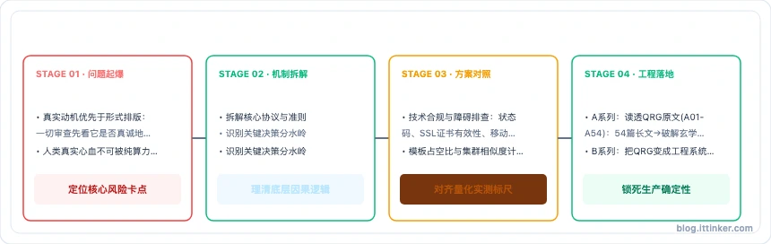
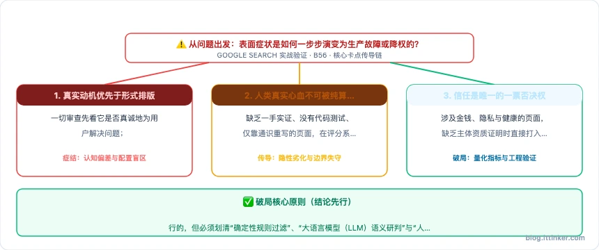
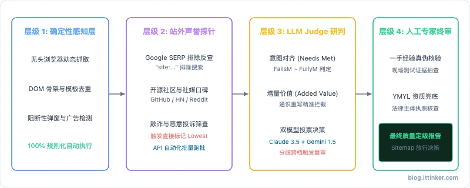
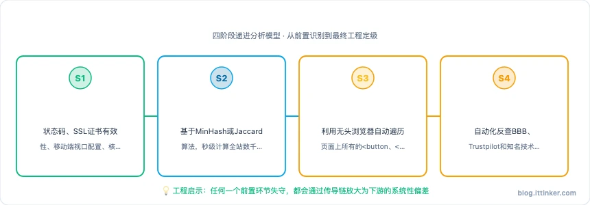
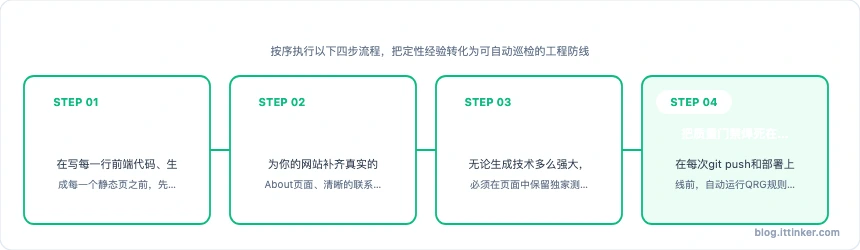

# “Google 圣经”能不能被做成一个自动化 SEO Audit Agent？全系列 110 篇终局收官与工程化架构 | 读懂 Google Search SEO 实战 系列 056

> 🌐 **在线阅读与互动版**：[“Google 圣经”能不能被做成一个自动化 SEO Audit Agent？全系列 110 篇终局收官与工程化架构 | 读懂 Google Search SEO 实战 系列 056](https://blog.ittinker.com/posts/google-圣经-能不能被做成一个自动化-seo-audit-agent/)
> 📚 **所属专栏**：[《读懂 Google Search：110篇搜索质量与SEO实战指南》](../README.md)

---

### 📌 结论先行（TL;DR）
**将 170 页的 Google QRG 转化为全自动化运行的 SEO Audit Agent 在工程上是完全可行的，但**必须划清“确定性规则过滤”、“大语言模型（LLM）语义研判”与“人类专家终审”的三道分界线**。**

1. 页面目的分类、模板占空比、代码交互报错与站外声誉初步扫雷可以实现 100% 自动化；
2. 但一手经验（Effort & Experience）的现场痕迹、深层信誉（Trustworthiness）以及事实权威性，仍需人工抽检把关。
3. 全系列 110 篇的核心，正是把这套心智模型沉淀为反脆弱的技术资产。

从第一篇探讨 Google 搜索的核心使命开始，到深入拆解 E-E-A-T、主内容心血、外链声誉穿透，再到实验室里对大模型盲测、pSEO 质量门禁与 SERP 重打分，我们跨越了整整 110 篇文章。

走完这趟长跑后，很多开发者脑海中自然浮现出一个极具工程诱惑的想法：

既然整部 QRG 是一套逻辑严密、条理分明的人工操作手册，我们能不能把它彻底封装为一个常驻后台的 **SEO Audit Agent**？让它自主抓取网页、对比 SERP、调用大模型打分，并实时输出诊断报告？

在全系列的最后一篇，我们将以这套自动化 Agent 的架构设计作为全书收官实录。





---

## 1. QRG 规范：全书核心原则的工程提炼

回顾整部指南，贯穿 170 页的底层准则可以被抽象为三个不可动摇的审查支柱：

> *"Trust is the most important member of the E-E-A-T family because untrustworthy pages have low PQ regardless of how Experienced, Expert, or Authoritative they may seem."*
> — **Google QRG 3.4《Trustworthiness》**

> *"High quality pages require a significant amount of effort, originality, talent, or skill. Pages created with little to no added value should be rated Low, regardless of how well they are formatted."*
> — **Google QRG 5.1《Effort, Originality, Talent, or Skill》**

无论我们设计多么前沿的 Agent，这三个支柱都是审查流程的基石：
1. **真实动机优先于形式排版**：一切审查先看它是否真诚地为用户解决问题；
2. **人类真实心血不可被纯算力伪造**：缺乏一手实证、没有代码测试、仅靠通识重写的页面，在评分系统中永远封顶在 Low；
3. **信任是唯一的一票否决权**：涉及金钱、隐私与健康的页面，缺乏主体资质证明时直接打入 Lowest。





---

## 2. QRG Audit Agent 端到端工程架构图

下面的矢量图展示了结合爬虫引擎、规则过滤器、LLM 裁判与人工抽检的四层混合架构：





---

## 3. 自动化能力的不可逾越之界

在构建 QRG Audit Agent 时，最忌讳的是盲目把一切判定全权交给 AI。工程架构必须清晰划分边界：

### 能够并且必须 100% 自动化的部分
1. **技术合规与障碍排查**：状态码、SSL 证书有效性、移动端视口配置、核心 Web 指标（LCP/CLS）。
2. **模板占空比与集群相似度计算**：基于 MinHash 或 Jaccard 算法，秒级计算全站数千个页面的结构相似度，自动抓出缺乏独有内容的克隆页面。
3. **功能性死链与假按钮**：利用无头浏览器自动遍历页面上所有的 `<button>`、`<form>` 与转译执行按钮，监测控制台报错。
4. **负面声誉高危词初筛**：自动化反查 BBB、Trustpilot 和知名技术论坛，提取与目标域名强相关的“scam”、“fraud”、“malware”关键词。

### 必须依赖人类专家最终裁决的部分
1. **一手经验（First-hand Experience）的真假甄别**：
   大语言模型能够轻易写出看似真诚的评测语气，甚至捏造逼真的“踩坑经历”。唯有人类资深工程师在审查代码日志、硬件拓扑图和性能基准测试时，能通过微妙的细节识破造假。
2. **商业主体信誉与现实危害审查（YMYL）**：
   涉及医疗处方、虚拟货币理财或企业级数据托付时，AI 无法承担法律责任。必须由人工核查其商业注册编号、真实实体办公地址以及法律免责协议。





---

## 4. 全系列 110 篇大总结：从盲人摸象到体系化工程

从 A 系列（理论解构，54 篇）到 B 系列（实战实验，56 篇），我们共同完成了对 Google 搜索机制的认知蜕变：

| 系列阶段 | 篇幅规模 | 核心解决的核心问题 | 带来的思维认知升级 |
| :--- | :--- | :--- | :--- |
| **A 系列：读透 QRG 原文** (A01 - A54) | 54 篇长文 | 破解玄学 SEO 传言，系统还原 Google 评估员指南的 170 页真实文字体系。 | **彻底告别关键词堆砌**。认识到 Google 评价的是“页面目的（Purpose）”、“主内容心血（MC Effort）”、“独立声誉（Reputation）”与“信任底座（Trust）”。 |
| **B 系列：把 QRG 变成工程系统** (B01 - B56) | 56 篇实战 | 将纸面上的评估准则转化为代码门禁、模型评测、GSC 指标看板与自动化工作流。 | **从靠运气排位转向严密的数据证伪**。搭建上线门禁（Quality Gate），用 Needs Met 重审 SERP，建立 14/30/60 天熔断止损机制。 |
| **终局合力：110 篇大成** | 全景体系 | 打造出海技术团队的高抗风险 SEO 资产工程系统。 | **做值得被索引的优质内容与工具**。不把精力浪费在取悦爬虫的雕虫小技上，专注为真实用户提供难以替代的增量价值。 |


---

## 5. 出海独立开发者终局行动清单

在结束全书旅程、开始落地你的出海项目时，请随身带好这份浓缩的心法清单：

- [ ] **建立以 Purpose 为先导的页面设计哲学**：在写每一行前端代码、生成每一个静态页之前，先用一句话写出该页面的有益目的（Beneficial Purpose）。
- [ ] **坚守 Trust 底线，拒绝主体隐匿**：为你的网站补齐真实的 About 页面、清晰的联系方式、公开透明的隐私与退款政策。
- [ ] **在主内容中注入不可替代的人类心血**：无论生成技术多么强大，必须在页面中保留独家测试数据、自研交互组件或一手排障实录。
- [ ] **把质量门禁焊死在 CI/CD 流程中**：在每次 `git push` 和部署上线前，自动运行 QRG 规则扫描与 AI 语义抽检，劣质页面坚决不给入口。
- [ ] **保持冷血的证伪与止损纪律**：按 14/30/60 天周期追踪收录与真实曝光，及时清理低效僵尸页面，保护主站长久声誉。

针对出海服务的高可用部署、隧道通信与反向代理自动化，建议随时复用开源维护脚本：

```bash
# 一键初始化海外独立开发者的安全网络与域名基线
curl -fsSL https://raw.githubusercontent.com/ittinker-author/ittinker-scripts/main/cloudflare-domain-baseline/setup.sh | bash
```





---

## 全书结语

读懂 Google Search，最终的收获并不是掌握了多少绕过规则的黑巧，而是站在整个互联网最严谨的质量评价体系高度，重新审视自己的代码与内容。

**当你做出的工具真正好用到让用户毫不犹豫按下复制，当你写出的文章真正详实到让同行保存为书签，全网最好的排名与持续的商业回报，只是这一旅程中自然而然的副产物。**

致敬每一位在数字出海征程中真诚创造价值的独立开发者！


---

## 读懂 Google Search 专栏导航

> 📚 **专栏收录**：本文为 [《读懂 Google Search：110篇搜索质量与SEO实战指南》](/posts/google-search-guide/) 第 **B56** 篇。

* **专栏主页**：[《读懂 Google Search：110篇搜索质量与SEO实战指南》全景地图与路线图](/posts/google-search-guide/)
